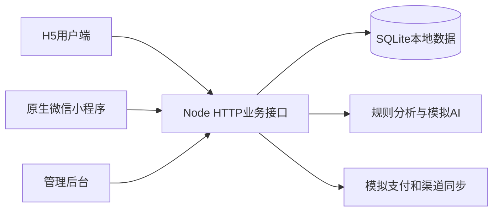
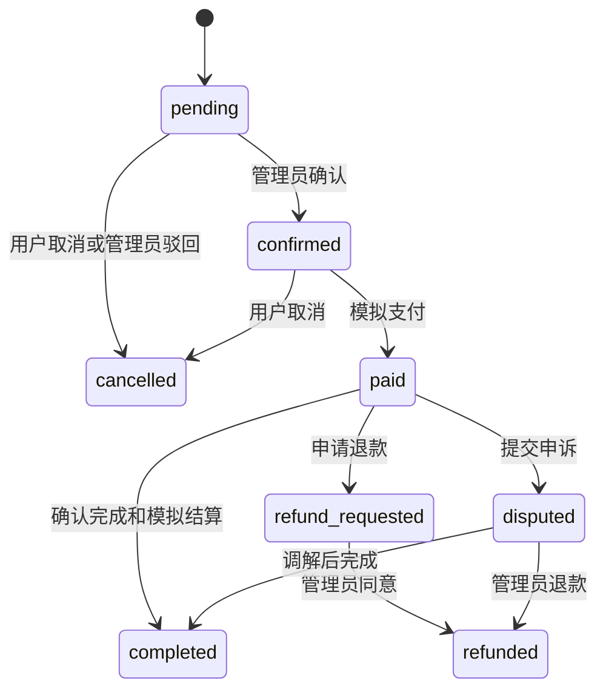

# 概要设计协作初稿

## 项目目的与范围

桂演是面向广西演艺资源展示、合作对接和预约管理的三端毕业实习Demo。H5与原生微信小程序提供用户服务入口，电脑管理后台提供资源、审核、订单与运营管理入口。项目遵循先基础、后智能、再优化的建设路径。

本稿供小组设计、开发、测试和答辩使用。依据为老师提供的功能模块汇总表、概要设计示例、数据库模板以及当前实际代码。正式项目编号、单位、成员姓名、版本和审批信息待小组补充，不沿用教务或新闻系统示例的名称和技术选型。

## 用户与权限

普通用户可浏览、搜索、收藏、预约、管理自己的订单、发布待审核需求、评论和站内沟通。资源合作方使用supplier演示角色参与需求与资源合作。管理员管理资源、确认订单、审核内容、处理售后、查看全量统计与操作日志。当前资源写入由管理员统一完成，未实现独立供应商资源后台。

## 核心业务流程

资源浏览与选择→提交预约→后台确认→用户模拟支付→服务完成→模拟结算。场馆和设备按天独占，重复档期拒绝；普通资源提交时扣减库存，取消或退款释放库存。支付前允许按规则取消，支付后可申请退款或申诉，由管理员处理。

需求和评论先提交审核，再公开展示；用户能看到自己提交的待审核内容。身份认证仅为本地演示状态，不采集真实证件。推荐按兴趣分类，画像标签按模拟订单数据计算。客服、问数、文案由本地规则与模板生成。

## 系统模块与分工

资源由2号负责；预约交易由3号负责；需求互动由4号负责；用户画像由5号负责；智能服务由6号负责；分析预警由7号负责；1号集成与总体设计；8号数据库和运行交付。具体姓名和接口修改先在分工表确认。

本文为基于当前Demo的协作初稿，尚需对应负责人核对、补充测试证据和最终审核。已实现、模拟、待完善内容应分别说明；不得把空白台账或规划当作已完成记录。

# 架构与数据说明

H5和管理后台使用 React 与 Vite；微信端使用原生 WXML、WXSS、JS。业务服务使用 Node 内置 HTTP 与 SQLite，避免额外安装数据库。外部能力统一在本地服务中模拟，不需要API密钥。

## 业务规则

- 角色为普通用户、资源合作方和管理员。后台写资源、审核、查看全量订单和统计均需管理员。
- 用户只能操作自己的订单。管理员能够审核和处理退款纠纷。
- 场馆与设备资源按天独占，同一天存在未取消、未退款订单时拒绝重复预约。
- 普通资源提交预约时扣减可用库存，取消或退款后释放库存。整个过程使用SQLite事务。
- 金额用整数分保存，展示时转换为元。
- 评论与需求审核通过后才公开；用户可以看到自己尚未公开的内容。
- 标签来自订单数量和已支付金额，推荐优先展示用户选择的兴趣分类。

## 数据表

| 表 | 用途 |
|---|---|
| users | 账号、密码哈希、角色、基础属性、偏好、演示认证状态 |
| sessions | 随机会话令牌、用户、有效期 |
| resources | 10类资源、价格、库存、容量、标签、扩展元数据、上下架、浏览量 |
| orders | 预约日期、数量、金额、渠道、订单状态、模拟托管、售后原因 |
| demands | 合作需求、预算、分类、城市、审核状态 |
| comments | 综合评分、质量/服务/价值分项JSON、评论、回复、审核状态 |
| messages | 站内通知、私信、已读状态 |
| favorites | 用户与资源的收藏关联 |
| events | 资源浏览等本地事件 |
| audit_logs | 登录、资源变更、订单、同步与审核操作记录 |
| settings | 库存阈值等演示配置 |

实体和字段定义以 `server/db.mjs` 的建表语句为准；正式数据库设计文档可依据这些真实实现填写。

## 主要API

| 路径 | 方法 | 用途 |
|---|---|---|
| /api/login、/api/register、/api/logout | POST | 模拟账号认证 |
| /api/bootstrap | GET | 按角色返回页面数据 |
| /api/resources | POST | 管理员新增资源 |
| /api/resources/:id | PATCH | 管理员编辑、上下架 |
| /api/resources/:id/view | POST | 浏览事件 |
| /api/resources/:id/sync | POST | 模拟剧目三渠道发布 |
| /api/availability | GET | 查询资源占用日期 |
| /api/orders | POST | 提交预约 |
| /api/orders/:id | PATCH | 状态机操作 |
| /api/orders/:id/contract | GET | 模拟服务或授权协议 |
| /api/demands、/api/comments | POST | 提交待审核内容 |
| /api/moderate | POST | 管理员审核或回复 |
| /api/favorites | POST | 收藏切换 |
| /api/profile | PATCH | 资料、兴趣和演示认证 |
| /api/messages、/api/messages/read | POST | 私信、通知与已读 |
| /api/analytics | GET | 日周月季度聚合及预警 |
| /api/alerts | POST | 模拟五类异常及处理 |
| /api/export | GET | CSV订单导出 |
| /api/sync | POST | 模拟渠道订单汇聚 |
| /api/ai | POST | 规则客服、运营分析、模板文案 |
| /api/settings | PATCH | 管理员修改阈值 |

认证头为 `Authorization: Bearer <演示会话令牌>`。所有SQL使用参数化查询；表名只来自服务端固定白名单。

## 后续对接

目前内部API真实执行数据库读写，外部服务全部模拟。若以后接入微信登录、支付、短信或AI，应在服务端新增适配层，保留现有前端与业务状态机；真实API密钥不能放入H5或小程序源码。任何真实支付或版权交易都超出当前Demo范围。

## 异常与运行设计

接口统一返回可读错误；没有登录返回401，越权返回403，档期冲突或不允许的状态流转返回409。提交内容校验长度、数量、日期、分类与金额。公开评论平均分只计算已通过审核的记录。权限由服务端校验，关键库存和订单修改使用事务。

网页端每15秒刷新业务数据，小程序重新进入页面读取最新状态。开发环境使用5173网页端口与3001API端口；构建后Node服务同时提供网页和API。数据库首次启动初始化，不随刷新重置。

## 后续需完善的图与内容

按当前实现绘制三端架构图、角色用例图、预约状态图、审核流程图；8号提供ER图。各负责人补充关键界面截图、适用异常及验证证据。性能、并发和真实接口指标没有测量时标注待验证，不虚构达标数字。
